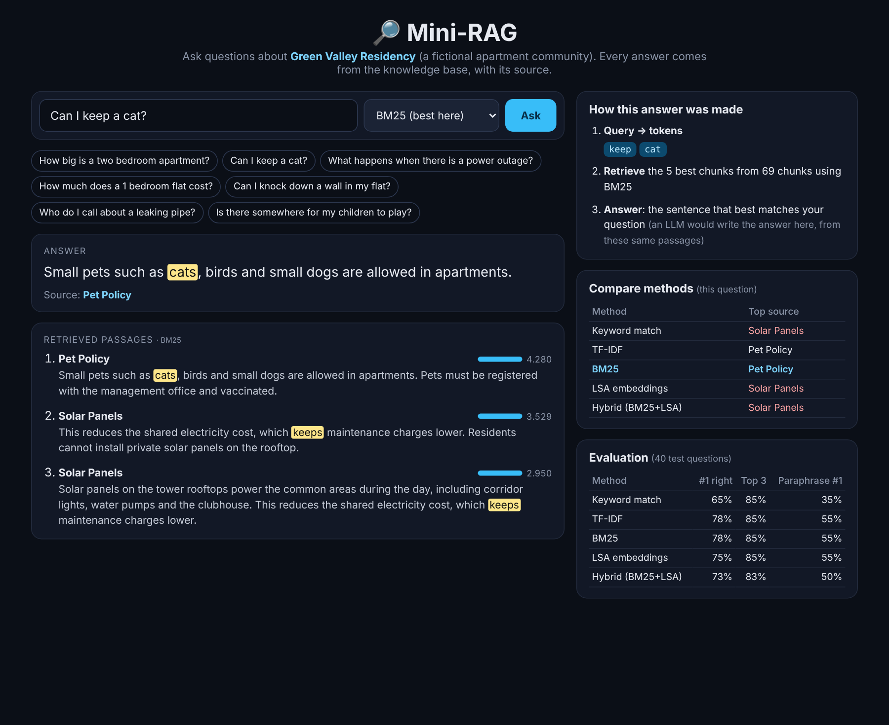
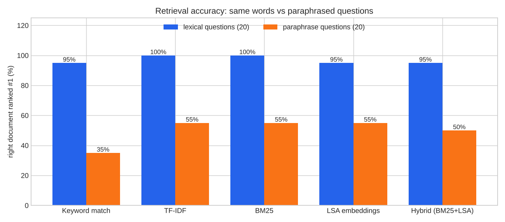
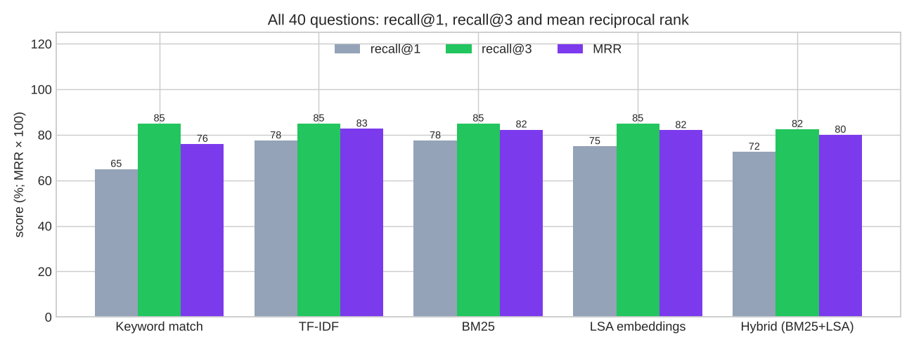
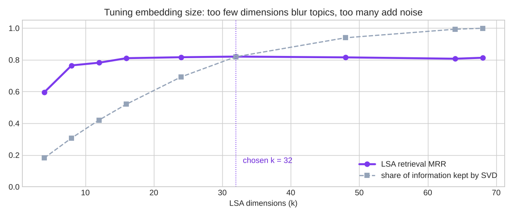
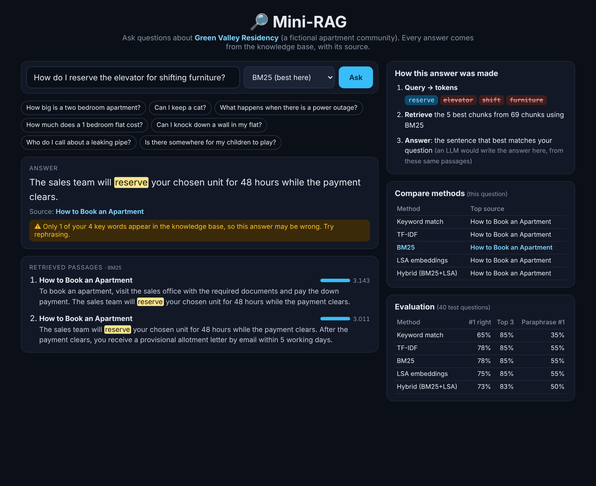

# 🔎 Mini-RAG: Retrieval-Augmented Generation from Scratch

A complete **RAG pipeline built from scratch** in Python and JavaScript: chunking, **5 retrieval methods**, extractive answering with citations, and an evaluation on 40 test questions. It answers questions about **Green Valley Residency**, a *fictional* apartment community used as demo data.

RAG is the technique behind "chat with your documents" chatbots. **Retrieval decides the quality of the answer.** If the right passage isn't found, even the best LLM can't answer correctly. This project measures that step honestly.



## Results: which retrieval method is best?



| Method | Right doc ranked #1 | In top 3 | MRR | Paraphrased questions #1 |
|---|---|---|---|---|
| Keyword match | 65% | 85% | 0.760 | 35% |
| TF-IDF | 78% | 85% | 0.827 | 55% |
| **BM25** | **78%** | **85%** | **0.823** | **55%** |
| LSA embeddings | 75% | 85% | 0.820 | 55% |
| Hybrid (BM25 + LSA) | 73% | 83% | 0.800 | 50% |

**Recommendation: BM25.** It ties with TF-IDF for the best accuracy, it's the industry-standard baseline (used by Elasticsearch and Lucene), and it needs no training. It's the app's default.

### What the numbers show
1. **Same words → almost perfect.** With the documents' own wording, TF-IDF and BM25 find the right document **100%** of the time.
2. **Paraphrases → about half fail.** "Can I reserve the *elevator*?" fails because the documents say "*lift*". Word-matching methods can't know they mean the same thing.
3. **LSA embeddings didn't fix that.** LSA learns word meanings only from this small knowledge base (69 chunks). Words like *flat*, *elevator* and *wifi* never appear in it, so it can't connect them to *apartment*, *lift* and *internet*.
4. **Hybrid was slightly worse.** Fusing BM25 with an equally limited method added noise. For example, "Can I *keep* a cat?" got pulled toward a solar-panel sentence ("which *keeps* maintenance charges lower").

**What would fix paraphrases:** a pre-trained **neural embedding model** (for example `all-MiniLM-L6-v2` or an embeddings API). It has learned from billions of sentences that *flat ≈ apartment*. It couldn't be downloaded in the environment this was built in, so it isn't included or claimed here. It's the natural next step: add it as a sixth retriever and fuse it with BM25. Hybrid search works best when the two methods fail on *different* questions.





LSA embedding size was tuned like a hyper-parameter: 4 dimensions blur topics together (MRR 0.60), and gains level off around 16–32 (best 0.82 at k = 32).

## The app

Open `web/index.html` in your browser (no install or server needed).

- Ask a question, or click an example
- **Answer** with the key words highlighted and its **source**
- **Retrieved passages** with relevance scores (only real matches are shown)
- **How this answer was made:** your question as tokens, with words the knowledge base doesn't know shown ~~crossed out~~
- **⚠ Low-confidence warning** when most of your words aren't in the knowledge base, instead of a confident wrong answer
- **Compare methods:** which source each of the 5 methods would pick for *your* question
- The **evaluation table** from the 40-question test



## How it works

```
Question → tokenize → RETRIEVE top chunks → ANSWER from those chunks (+ source)
                         ▲
Documents → chunk → index (TF-IDF / BM25 / LSA)
```

1. **Chunking:** each document is split into overlapping 2-sentence windows (31 documents → 69 chunks). Small chunks give precise matches, and the overlap keeps context. Each chunk's title is searchable too.
2. **Tokenizing:** lowercase, remove stop-words ("the", "is", "can"…), and stem ("apartments" → "apartment").
3. **The 5 retrievers:**
   - **Keyword match:** counts how many question words appear in the chunk.
   - **TF-IDF:** words weighted by rarity (rare words like "cat" matter more than "apartment"), then cosine similarity.
   - **BM25:** like TF-IDF, but repeating a word has diminishing returns, and long chunks are penalised. It's the standard search-engine formula.
   - **LSA:** SVD compresses the 434-word TF-IDF space into 32 "topic" dimensions, giving dense embeddings compared by cosine similarity.
   - **Hybrid:** *reciprocal rank fusion* (`score = Σ 1/(60 + rank)`) of BM25 and LSA.
4. **Answer:** from the top 3 chunks, the sentence with the most rare question words. **An LLM would replace this step:** give it the retrieved passages plus the question, and ask it to answer *only from those passages* and cite them.
5. **Evaluation:** 40 hand-written questions with the correct document. Half use the documents' wording and half are paraphrases. Metrics: recall@1, recall@3 and MRR (mean reciprocal rank).

## Run it yourself

```bash
pip install -r requirements.txt
python rag/evaluate.py      # builds the index, tunes LSA, evaluates all methods, saves charts, exports web/index_data.js
node web/test.js            # 8 tests: JS = Python for every method on all 40 questions
```

**Use your own documents:** replace `data/knowledge_base.json` (a list of `{id, title, text}`), write a few test questions in `data/questions.json`, and run the two commands above.

## Project structure

```
data/
  knowledge_base.json   # 31 fictional documents
  questions.json        # 40 test questions (lexical + paraphrase)
rag/
  text.py               # tokenizer, stop-words, stemmer, sentence splitter
  engine.py             # chunking, 5 retrievers, extractive answers
  evaluate.py           # metrics, LSA tuning, charts, export
  results.json          # scores + which questions each method missed
web/
  index.html, style.css, app.js   # chat UI, pipeline view, method comparison
  rag.js                # the same engine in JavaScript
  index_data.js         # exported index (generated)
  test.js               # 8 parity tests
screenshots/
```

## License

MIT
